<picture>
  <source media="(prefers-color-scheme: dark)" srcset="assets/header-dark.svg">
  
</picture>

  

<picture>
  <source media="(prefers-color-scheme: dark)" srcset="assets/now-dark.svg">
  
</picture>

  

<a href="https://github.com/vNullptr/ai_jira_assistant"><picture>
  <source media="(prefers-color-scheme: dark)" srcset="assets/project-ai_jira_assistant-dark.svg">
  
</picture></a>
<a href="https://github.com/vNullptr/gdpr_qa_rag"><picture>
  <source media="(prefers-color-scheme: dark)" srcset="assets/project-gdpr_qa_rag-dark.svg">
  
</picture></a>

  

<picture>
  <source media="(prefers-color-scheme: dark)" srcset="assets/stack-dark.svg">
  
</picture>

  

<picture>
  <source media="(prefers-color-scheme: dark)" srcset="assets/log-dark.svg">
  
</picture>

  

<picture>
  <source media="(prefers-color-scheme: dark)" srcset="https://raw.githubusercontent.com/vNullptr/vNullptr/output/snake-dark.svg">
  
</picture>

  

~ <i>calm by nature. precise by choice.</i> ~

<!--
  everything above is rendered from profile.toml by scripts/render.py.
  to update the cards: edit profile.toml and push. the workflow does the rest.
-->
